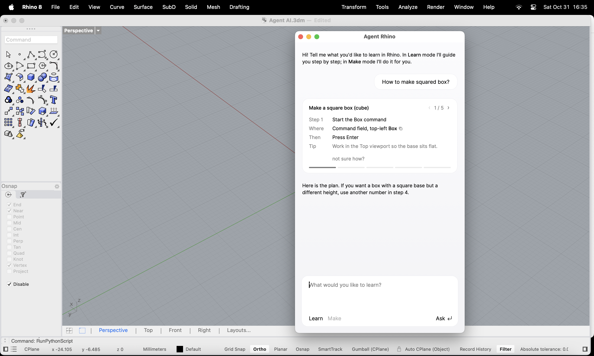

# AI Agent for Rhino 3D

A learning and modeling assistant that lives **inside Rhino 8** as a chat window.
Ask it how to model something and it guides you step by step, or let it build the geometry for you
and explain how you would do it yourself.



## What it does

- **Learn mode**: shows the whole task as a step card. Steps tick themselves off when you run the
  step's command or switch to the right viewport, so you never have to report progress manually.
  When you finish, the agent checks your result and sums up what you learned.
- **Make mode**: does the task with its tools and then tells you which commands you would use.
- **Sees your work**: reads objects, layers, selection and recent commands, and takes a screenshot
  of the viewport that the model analyses as an image.
- **Writes and runs code (with approval)**: for anything beyond the simple tools (booleans, arrays,
  parametric shapes) the agent writes Python. You first see a plain-language plan, then click
  **Run** or **Cancel**. The code itself is collapsed. Each run is one undo step, and errors are sent back
  so the agent can fix its own code.
- **Grasshopper**: reads the canvas (components, wiring, sliders, errors), moves sliders and
  highlights the component it is talking about.

## How it works

```
user message ─► Claude (Messages API, tool use) ─► tool call ─► Rhino / Grasshopper
      ▲                                                              │
      └──────────────── tool result (text or image) ◄────────────────┘
```

- **Hand-written agent loop.** No framework is used: the loop calls the API, runs the requested tools,
  sends back `tool_result`s and repeats until the model is done.
- **20 tools** described with JSON Schema, covering reading the model, geometry, commands, code
  execution, Grasshopper and the learning plan.
- **Threads.** API calls run in the background, and everything that touches the document or UI is
  marshaled to Rhino's main thread, so Rhino never freezes.
- **Robustness.** Conversation history is repaired if a tool call is interrupted, concurrent requests
  are blocked, and every change the agent makes can be undone with Cmd+Z.
- **UI.** It was designed in Figma and built with HTML/CSS/JS in an Eto.Forms WebView. JS talks to Python through
  a custom `agent://` URL scheme. Light and dark themes follow macOS.
- **No dependencies.** It uses Rhino's own Python 3 and .NET `HttpClient` for the API calls.

## Setup

1. Rhino 8 (tested on macOS).
2. An API key from the [Claude Console](https://platform.claude.com/). Add it to `~/.zshrc`:
   ```bash
   export ANTHROPIC_API_KEY="your-key"
   ```
   The script reads the key from there. The key is never stored in the code.
3. In Rhino, run `RunPythonScript` and pick `rhino_agent.py`.
   Tip: add an alias, e.g. `agent` → `_-RunPythonScript "/path/to/rhino_agent.py"`.

Settings at the top of the file:

| Setting | Default | Meaning |
| --- | --- | --- |
| `MODEL` | `claude-sonnet-5-5` | Claude model used by the agent |
| `MOTYW` | `"auto"` | Theme: `"auto"`, `"ciemny"` (dark) or `"jasny"` (light) |
| `POTWIERDZAJ_KOD` | `True` | Ask before running code written by the agent |

## Project history

1. A minimal agent loop in the terminal with the Anthropic Python SDK and file tools, built to understand
   how tool use works.
2. The loop was moved into Rhino with Rhino-specific tools and a chat window.
3. The UI was redesigned in Figma. Learn and Make modes, auto-ticking steps, code execution with
   approval, viewport vision and Grasshopper tools were added.

Built in collaboration with Claude: I set the direction, designed the interface and tested
everything in Rhino, while AI helped write the code. Code comments and some identifiers are in Polish.

## Ideas / next steps

- Project notes so the agent remembers decisions between sessions
- A guided course: modeling a parametric skyscraper in Rhino and Grasshopper
- A docked Rhino panel instead of a floating window
